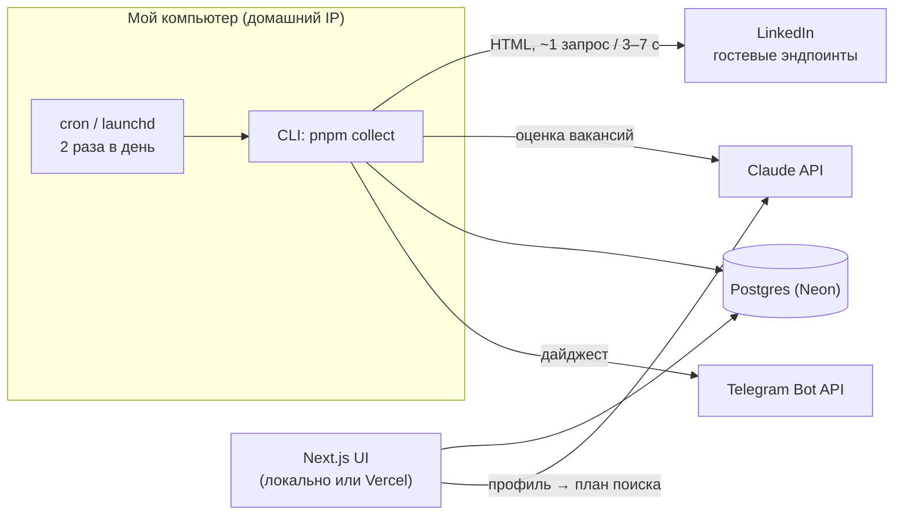
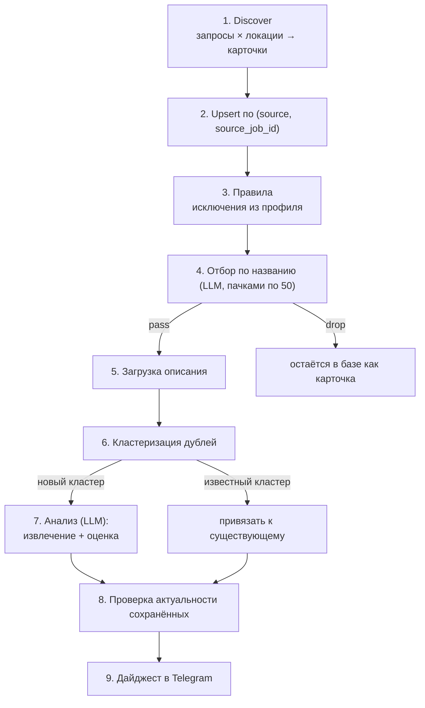

# Техническая спецификация (v1)

Контекст и сценарии — в [01-user-flow.md](./01-user-flow.md). Здесь — как это устроено.

## 1. Рамки

- Один пользователь, один источник (LinkedIn), один процесс сбора. Никаких очередей, воркеров и масштабирования.
- Ориентир по объёму: 10–15 запросов × 1–3 локации, 300–1000 новых карточек в день, из них 100–300 доходят до LLM‑оценки.
- Сбор идёт только через публичные гостевые страницы LinkedIn, без логина и без cookies моего аккаунта.

**Что не проверено.** Гостевые эндпоинты LinkedIn не документированы; параметры и лимиты ниже взяты из открытых скрейперов (JobSpy) и статей 2026 года. Из облачной среды, где писалась спека, linkedin.com недоступен, так что живьём я их не проверял. Поэтому первым шагом реализации стоит спайк (§12, M0), и от его результата зависит выбор между своим фетчером и платным API.

## 2. Архитектура



Три части в одном репозитории и одном пакете:

1. **Collector** — CLI‑скрипт на Node. Запускается по расписанию, проходит весь пайплайн и завершается.
2. **База** — Postgres. Единственное общее состояние.
3. **UI** — Next.js, читает и пишет в базу напрямую (server components + server actions).

Collector и UI связаны только через базу. Это главное архитектурное решение: скрейперу нужен «домашний» IP (с датацентровых LinkedIn отдаёт 429/999 гораздо чаще), а UI удобно держать включённым всегда. Облачная база позволяет запускать их в разных местах и позже перенести сбор на VPS с прокси или на платный API, не трогая остальное.

## 3. Стек

| Слой | Выбор | Почему |
|---|---|---|
| Язык | TypeScript, Node 22, pnpm | один язык на всё, мой основной стек |
| UI | Next.js (App Router), Tailwind, shadcn/ui | быстро собрать inbox; server actions вместо отдельного API |
| База | Postgres на Neon (free tier), Drizzle ORM | полнотекстовый поиск, JSONB для извлечённых полей, pgvector на будущее; доступна и с ноутбука, и с Vercel |
| Сбор | встроенный `fetch`, `cheerio`, `zod` | гостевые эндпоинты отдают готовый HTML, браузер не нужен |
| LLM | Claude API, `@anthropic-ai/sdk`, structured outputs | разбор профиля, отбор по названию, оценка |
| Расписание | cron / launchd на моей машине | бесплатно и с домашним IP |
| Уведомления | Telegram Bot API | один HTTP‑запрос, работает на телефоне |
| Тесты | vitest + сохранённые HTML‑фикстуры | парсеры — самое хрупкое место |

Альтернатива «всё локально на SQLite» проще на час‑два, но привязывает UI к включённому ноутбуку и усложняет перенос сбора. Neon бесплатен и снимает оба вопроса.

Доступ к UI на Vercel: одна переменная окружения с паролем + middleware. Полноценная авторизация в v1 не нужна.

## 4. Источник: LinkedIn

### 4.1 Эндпоинты

| Назначение | URL | Ответ |
|---|---|---|
| Поиск | `GET https://www.linkedin.com/jobs-guest/jobs/api/seeMoreJobPostings/search?keywords=…&location=…&start=N` | HTML‑фрагмент со списком карточек |
| Вакансия | `GET https://www.linkedin.com/jobs-guest/jobs/api/jobPosting/{jobId}` | HTML‑фрагмент с описанием |

Параметры поиска (проверить в спайке):

| Параметр | Значение |
|---|---|
| `keywords` | поддерживает кавычки, `AND` / `OR` / `NOT`, скобки |
| `location` / `geoId` | текст локации или id региона |
| `f_TPR` | `r86400` — сутки, `r604800` — неделя; по сообщениям, принимает произвольное число секунд |
| `f_WT` | `1` onsite, `2` remote, `3` hybrid |
| `f_E` | уровень: `4` mid‑senior, `5` director и т.д. |
| `f_JT` | `F` full‑time, `C` contract |
| `sortBy` | `DD` — по дате |
| `start` | смещение |

Известные ограничения:

- **Не больше ~1000 результатов на запрос**: на `start=1000` эндпоинт отвечает 400. Обходится сужением запроса, а нам столько и не нужно.
- **Размер страницы**: источники расходятся (10 или 25). Поэтому `start` увеличивается на число реально полученных карточек.
- **Блокировки**: 429 при всплесках (по README JobSpy снимается примерно за минуту), иногда 999 или редирект на страницу логина. Оценки порога — от 50–100 быстрых запросов с одного IP.

Что берём с карточки: `jobId` (из `data-entity-urn`), название, компания и её URL, локация, дата публикации (`<time datetime>`), URL. Со страницы вакансии: HTML описания, критерии (уровень, тип занятости, функция, отрасль), число откликов, внешняя ссылка для отклика, признак «больше не принимает отклики».

### 4.2 Политика запросов

- Один запрос за раз, пауза 3–7 секунд со случайным разбросом.
- На 429 / 999 / редирект на логин: пауза 60 с → 5 мин → прогон останавливается и помечается `partial`. Следующий прогон доберёт остаток, потому что всё идемпотентно (§10).
- Дневной потолок — 600 запросов, чтобы ошибка в коде не превратилась в бан IP.
- Обычный браузерный `User-Agent`; cookies не используются.

Ожидаемая нагрузка в обычный день: ~40 запросов поиска + 100–300 страниц вакансий + до 50 проверок актуальности ≈ 200–400 запросов, 15–35 минут суммарно на два прогона.

### 4.3 Запасной вариант: платный API

Источник спрятан за интерфейсом, чтобы замена не затрагивала остальной пайплайн:

```ts
interface JobSource {
  search(q: SearchQuery, window: { sinceSeconds: number; maxCards: number }): AsyncIterable<JobCard>;
  fetchDetails(sourceJobId: string): Promise<JobDetails | { closed: true }>;
}
```

Вторая реализация — актор Apify. На Apify Store десятки сторонних LinkedIn‑скрейперов «без логина» с оплатой за результат, от $0.30 до $1 за 1000 вакансий у самых дешёвых (цены со страниц акторов, перед выбором сверить). При 300 вакансиях в день это $3–9 в месяц. Минусы: зависимость от стороннего автора и разный набор полей у разных акторов.

**Правило выбора (по итогам спайка):** если с домашнего IP 300 запросов в темпе §4.2 проходят с долей блокировок < 5 % — свой фетчер. Иначе — Apify основным источником, свой фетчер только для проверок актуальности.

### 4.4 Условия использования

Пользовательское соглашение LinkedIn запрещает автоматический сбор. Что это значит на практике для личного проекта: риск — блокировка IP, а не аккаунта, потому что логин не используется. Чтобы так и оставалось: не использовать cookies своего аккаунта, держать низкий темп, не публиковать и не перепродавать собранные данные. Если проект станет публичным сервисом, вопрос нужно решать заново (официальные партнёрские API или лицензированные поставщики данных).

## 5. Пайплайн одного прогона



Смысл воронки — тратить дорогие ресурсы (запросы к LinkedIn и вызовы LLM) только на то, что прошло дешёвые шаги:

1. **Discover.** Для каждой пары «запрос × локация» листаем поиск с `sortBy=DD` (§7).
2. **Upsert.** Новая карточка создаётся, у известной обновляется `last_seen_at`. В `job_hit` пишется, какой запрос её нашёл.
3. **Правила.** Исключённые компании и слова в названии — обычный код, без LLM.
4. **Отбор по названию.** LLM получает профиль и пачку из 50 строк «название — компания — локация» и возвращает `pass / drop` для каждой. При сомнении — `pass`. Ожидаемо отсекает 50–70 % карточек до загрузки описаний.
5. **Загрузка описания** только для `pass`.
6. **Кластеризация** (§6).
7. **Анализ.** Один вызов LLM на кластер: извлечение фактов + оценка под профиль (§8).
8. **Актуальность** (§7.3).
9. **Дайджест**: новые кластеры с оценкой ≥ порога, которых ещё не было в прошлых дайджестах.

Карточки, отсечённые на шагах 3–4, остаются в базе без описания: они нужны для поиска по названию, статистики запросов и как грубый рыночный сигнал.

## 6. Дедупликация

Три уровня, от точного к приблизительному:

| Уровень | Что ловит | Как |
|---|---|---|
| 1. Идентификатор | одна вакансия найдена несколькими запросами или в нескольких прогонах | уникальный ключ `(source, source_job_id)`, upsert |
| 2. Содержимое | одна роль в 20 городах; перевыкладывание с новым id | `fingerprint = sha256(norm(company) + norm(title) + norm(description))` → общий `cluster_id` |
| 3. Между источниками (позже) | та же вакансия на Indeed и LinkedIn | тот же fingerprint без привязки к источнику + нечёткое сравнение |

Нормализация для уровня 2: нижний регистр, удалить HTML, пунктуацию и повторные пробелы; из названия убрать локацию и пометки вроде «(Remote)», «m/f/d»; у компании убрать «Inc», «GmbH», «Ltd».

Что даёт кластер:

- в интерфейсе — одна карточка «ещё N локаций / перевыложена»;
- LLM‑анализ выполняется один раз на кластер, а не на каждую копию;
- пользовательский статус (скрыл, сохранил) относится к кластеру: скрытая вакансия не всплывёт снова после перевыкладывания.

Точный хэш пропустит копии, где описание изменено на пару слов. Для v1 это приемлемо: худший случай — лишняя карточка в ленте. Если будет мешать — заменить на simhash с порогом по расстоянию Хэмминга, структура таблиц для этого не меняется.

## 7. Сбор и актуализация

### 7.1 Расписание

| Задача | Когда | Зачем |
|---|---|---|
| Сбор новых | 2 раза в день, например 08:00 и 18:00 | на свежие вакансии важно откликаться в первые сутки; чаще — растёт риск блокировки без заметной пользы |
| Проверка актуальности | внутри утреннего прогона | не показывать закрытое |
| Дайджест | после утреннего прогона | один раз в день |
| Первичный сбор | один раз при онбординге, растянут на 1–2 дня при блокировках | наполнить базу |

### 7.2 Окно и глубина

- **Обычный прогон.** Окно `f_TPR = r{секунд с последнего успешного прогона этого запроса + 2 часа}`. Если ноутбук был выключен три дня, окно само вырастет до трёх суток, и пропусков не будет. Если произвольные значения `f_TPR` в спайке не подтвердятся — округлять вверх до `r86400` / `r604800`.
- **Остановка листания**: пустая страница, либо страница целиком из уже известных `jobId`, либо потолок 5 страниц на пару «запрос × локация».
- **Первичный сбор.** Окно 14 дней (`r1209600`), потолок 500 карточек на пару. Глубже смысла мало: у вакансий старше двух недель сотни откликов, а гостевой поиск всё равно показывает только открытые. История для аналитики копится вперёд, а не назад.

### 7.3 Актуальность

Проверять все вакансии ежедневно — это тысячи запросов. Поэтому активная проверка только для тех, что важны:

| Группа | Проверка | Как |
|---|---|---|
| Сохранённые; новые с оценкой ≥ порога, ещё не просмотренные | раз в день | запрос страницы вакансии: 404 или пометка «No longer accepting applications» → `closed` |
| Остальные | пассивно | `last_seen_at` обновляется, когда вакансия снова попадает в выдачу |
| Опубликована > 30 дней назад и не встречалась 14 дней | — | `stale`, скрывается из Inbox |

При проверке пересчитывается `content_hash`. Если описание изменилось — повторный анализ.

## 8. LLM

### 8.1 Три задачи

| Задача | Частота | Вход | Выход (structured output) |
|---|---|---|---|
| A. Профиль и план поиска | при онбординге и правке профиля | резюме, «что ищу», ограничения | навыки с уровнями, роли по группам core / adjacent / stretch, запросы для LinkedIn |
| B. Отбор по названию | каждый прогон, пачки по 50 | профиль + список «название — компания — локация» | `pass / drop` на каждую строку |
| C. Анализ вакансии | один раз на кластер | профиль + примеры из калибровки + описание | `extraction` и `match` (ниже) |

Результат задачи C:

```ts
{
  extraction: {            // не зависит от пользователя → основа рыночной аналитики
    role_category: string, seniority: string,
    skills_required: string[], skills_nice: string[],
    work_mode: "remote" | "hybrid" | "onsite" | "unknown",
    geo_restrictions: string | null,       // «только US», «EU timezone ±2»
    salary: { min?: number, max?: number, currency?: string, period?: string } | null,
    company_type: string | null,           // стартап, агентство, enterprise…
    language: string
  },
  match: {                 // зависит от профиля
    score: number,                         // 0–100
    role_group: "core" | "adjacent" | "stretch" | "off",
    reasons: string[],                     // 2–4 пункта «почему подходит»
    gaps: string[],
    red_flags: string[],
    hard_constraint_violated: string | null // нарушено жёсткое ограничение → не показывать
  }
}
```

Реализация: `client.messages.parse()` со схемой Zod. Профиль, инструкция и калибровочные примеры идут неизменяемым префиксом с `cache_control`, описание вакансии — после него. Минимальный размер кэшируемого префикса зависит от модели, поэтому после запуска проверить `usage.cache_read_input_tokens`.

Обратная связь: вакансии, которые я сохранил или скрыл с причиной, попадают в префикс как примеры (до 10 каждого вида). Профиль получает новую версию; автоматически пересчитываются только новые вакансии, старые — по кнопке.

### 8.2 Модель и стоимость — решение за мной

Модель задаётся в конфиге отдельно для каждой задачи. Задачи A и «предложить новые роли» редкие, для них `claude-opus-5-5` без вопросов. Вопрос в массовой задаче C.

Оценка для 300 анализов в день (9000 в месяц), ~3000 входных и ~600 выходных токенов на вызов:

| Модель | Цена, вход / выход за 1M | В месяц | Через Batch API (−50 %) |
|---|---|---|---|
| `claude-opus-5-5` | $4 / $20 | ≈ $215 | ≈ $108 |
| `claude-sonnet-5-5` | $2 / $10 | ≈ $108 | ≈ $54 |
| `claude-haiku-5-5` | $0.10 / $0.50 | ≈ $5 | ≈ $3 |

Цифры приблизительные: реальная длина описаний и токены на размышление сдвинут их в обе стороны; кэширование префикса немного снижает входную часть. Задача B добавляет копейки на любой модели.

Предложение: начать задачи B и C на `claude-haiku-5-5`, а в M2 прогнать 50 вакансий через Haiku и Opus и сравнить оценки с моими собственными отметками. Если Haiku расходится со мной заметно чаще — поднять модель для C или сделать два прохода (Haiku для всех, старшая модель для оценок 60+). Batch API подходит для первичного сбора и пересчёта; для ежедневных прогонов он не нужен.

## 9. Модель данных

```
profile          id, version, resume_text, wishes_text, constraints jsonb,
                 structured jsonb, examples jsonb, updated_at

search_query     id, role_group, label, keywords, location, geo_id, filters jsonb,
                 enabled, last_success_at

run              id, kind (collect | backfill | recheck), started_at, finished_at,
                 status (ok | partial | failed), counters jsonb, error

job              id, source, source_job_id, url, title, company_name, company_url,
                 location_raw, posted_at, first_seen_at, last_seen_at, last_checked_at,
                 status (active | closed | stale),
                 triage (pending | pass | drop), triage_reason,
                 description_html, description_text, criteria jsonb, applicants_text,
                 apply_url, content_hash, cluster_id, detail_fetched_at
                 UNIQUE (source, source_job_id)

job_hit          job_id, search_query_id, run_id, seen_at

job_cluster      id, fingerprint UNIQUE, canonical_job_id, first_seen_at

job_analysis     cluster_id, extraction jsonb, model, prompt_version, created_at

job_match        cluster_id, profile_version, score, role_group, reasons jsonb,
                 gaps jsonb, red_flags jsonb, hard_constraint_violated, model, created_at

user_job_state   cluster_id, state (new | seen | saved | applied | hidden),
                 hide_reason, note, digest_sent_at, updated_at
```

- `job_analysis` и `job_match` разделены, хотя заполняются одним вызовом: извлечённые факты не зависят от профиля и переживают его правки.
- `job_hit` нужен для статистики запросов в интерфейсе («этот запрос нашёл 400 карточек, сохранил я из них ноль»).
- Поиск: сгенерированная колонка `tsvector` по названию, компании и тексту описания + индекс GIN; `pg_trgm` для поиска по компании с опечатками.
- Объём: ~8 КБ на вакансию с описанием. При 300 в день это ~70 МБ в месяц, бесплатных 0.5 ГБ Neon хватит на полгода. Когда упрёмся — удалять `description_html` у закрытых вакансий с низкой оценкой, оставляя извлечённые поля.

## 10. Надёжность без инфраструктуры

- **Идемпотентность.** Каждый шаг выбирает работу из базы по состоянию («карточки с `triage = pass` без `detail_fetched_at`», «кластеры без `job_analysis`»). Прогон можно убить в любой момент, следующий продолжит с того же места. Отдельной очереди нет.
- **Журнал прогонов.** Таблица `run` со счётчиками: запросов, блокировок, новых карточек, прошедших отбор, оценённых. Виден в интерфейсе.
- **Сторож парсера.** Каждая распарсенная карточка проверяется схемой Zod. Если > 20 % карточек страницы не проходят или страница неожиданно пуста — прогон останавливается, в Telegram уходит «похоже, LinkedIn поменял вёрстку». Молча получать пустую базу хуже, чем упасть.
- **Фикстуры.** Сохранённые HTML поиска, вакансии и закрытой вакансии лежат в репозитории, парсеры покрыты тестами на них. После смены вёрстки — обновить фикстуру, поправить селекторы.
- **Тишина.** Если успешного прогона не было 36 часов — сообщение в Telegram.
- **Потолки.** Запросов к LinkedIn в день (600) и вызовов LLM в день (настраивается), чтобы ошибка не стоила денег или бана.

## 11. Структура репозитория

```
app/                    # Next.js: inbox, search, profile, runs
src/
  db/                   # схема Drizzle, миграции
  sources/
    types.ts            # JobSource, JobCard, JobDetails
    linkedin/           # fetcher, парсеры, throttle
    apify/              # запасная реализация
  pipeline/             # discover, triage, details, cluster, analyze, recheck, digest
  llm/                  # промпты, схемы Zod, клиент
  profile/              # построение профиля и плана поиска
scripts/
  collect.ts            # точка входа: pnpm collect [--backfill]
  spike.ts              # проверка эндпоинтов (M0)
test/fixtures/          # HTML‑фикстуры
docs/
```

## 12. План реализации

| Этап | Что делаем | Готово, когда | Оценка |
|---|---|---|---|
| **M0. Спайк** | `scripts/spike.ts`: поиск, листание, страница вакансии, 300 запросов в рабочем темпе с домашнего IP | известны размер страницы, поведение `f_TPR`, доля блокировок; выбран источник по правилу §4.3; сохранены фикстуры | 2–3 часа |
| **M1. Сбор** | схема базы, `JobSource` для LinkedIn, discover + upsert + загрузка описаний + кластеры, журнал прогонов | `pnpm collect` по списку запросов из конфига наполняет базу; повторный запуск не плодит дубли | 1–2 дня |
| **M2. Профиль и оценка** | онбординг (пока CLI или простая форма), задачи A, B, C, сравнение моделей на 50 вакансиях | у вакансий есть оценки с объяснениями; выбрана модель для задачи C | 1–2 дня |
| **M3. Интерфейс** | Inbox, карточка, статусы, клавиатура, поиск | ежедневный разбор занимает пару минут | 1–2 дня |
| **M4. Автоматизация** | расписание, окно по `last_success_at`, проверка актуальности, дайджест, сторож парсера | неделя работы без ручного вмешательства | 1 день |
| **M5. Обратная связь** | калибровка, причины скрытия → примеры, статистика запросов, «предложить новые роли» | оценки заметно ближе к моим отметкам, чем в M2 | 1 день |

Пользоваться можно уже после M2 (запрос к базе вместо интерфейса), полноценно — после M4.

## 13. Риски

| Риск | Вероятность | Что делаем |
|---|---|---|
| LinkedIn поменяет вёрстку или закроет гостевые эндпоинты | вёрстка — периодически; закрытие — низкая | сторож парсера, фикстуры, готовая замена на Apify |
| Блокировки IP при первичном сборе | средняя | низкий темп, остановка и продолжение, растянуть на 2 дня |
| Оценки LLM не совпадают с моим вкусом | высокая на старте | калибровка, примеры из обратной связи, сравнение моделей в M2 |
| Отбор по названию отсекает хорошее | средняя | при сомнении `pass`; раз в неделю просматривать 20 случайных `drop` |
| План поиска пропускает целые классы ролей | средняя | широкие запросы в группе stretch, статистика запросов, «предложить новые роли» |
| Ноутбук выключен | — | окно само растягивается; при необходимости перенос сбора на VPS с резидентным прокси или на Apify |

## 14. Что нужно от меня до старта

1. Резюме и текст «что я ищу».
2. Локации и формат работы — от них зависит число запросов и вся нагрузка.
3. Решение по модели для массовой оценки (§8.2) — можно отложить до M2.
4. Токен Telegram‑бота, ключ Claude API, проект в Neon.
